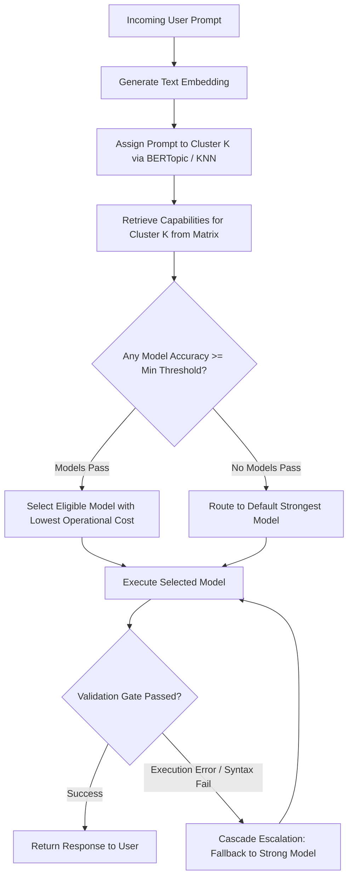

### Routing Architecture



---

# CAPABILITY MATRIX PLAN

## Phase 1: Benchmark Dataset Preparation & Evaluator Harness

Build automated, deterministic evaluation scripts for each domain category. Every benchmark must output a binary PASS (`1.0`) or FAIL (`0.0`) for every prompt without relying on an external LLM judge.

* [ ] **1.1 Setup Benchmark Data Ingestion Pipeline**
* Download and normalize datasets from Hugging Face (`datasets` library).
* Standardize prompt schema: `{"id": str, "domain": str, "prompt": str, "ground_truth": Any}`.


* [ ] **1.2 Mathematical & Quantitative Reasoning Evaluator**
* **Datasets:** GSM8K (`openai/gsm8k`), MATH-500 (`HuggingFaceH4/MATH-500`).
* **Evaluator Logic:**
* Append prompt instruction: `"Output the final numeric answer after '#### '."`
* Build regex extractor to parse LaTeX/numeric values immediately following `#### `.
* Implement float/fraction equivalence matcher (e.g., $0.5 == \frac{1}{2}$).


* [ ] **1.3 Code Generation & Execution Evaluator**
* **Datasets:** MBPP (`google-research-bsg/mbpp`), HumanEval Plus (`evalplus/humanevalplus`).
* **Evaluator Logic:**
* Extract generated Python code blocks (````python ... ````).
* Concatenate prompt function, generated code body, and test assertion code (`assert candidate_function(input) == output`).
* Run code inside an isolated `subprocess` sandbox with a strict 5-second timeout.
* Mark `1.0` if exit code is `0` (all assertions pass); mark `0.0` on `SyntaxError`, `AssertionError`, or `TimeoutExpired`.


* [ ] **1.4 Algorithmic & Multi-Step Logic Evaluator**
* **Dataset:** Big-Bench Hard (`maira-res/bbh`).
* **Evaluator Logic:**
* Parse target extraction strings (e.g., target option letters `(A)`, boolean `True/False`, or ordered list outputs).
* Match stripped predictions against exact target key.


* [ ] **1.5 Verifiable Instruction-Following Evaluator**
* **Dataset:** IFEval (`google/ifeval`).
* **Evaluator Logic:**
* Programmatically verify structural rules (e.g., `frequency_of_words`, `json_format`, `min_word_count`, `forbidden_words`).
* Mark `1.0` if all verifiable constraints pass; otherwise `0.0`.


---

## Phase 2: Feature Matrix Profiling Schema

Define the schema used to profile every candidate model in your fleet.

* [ ] **2.1 Empirical Accuracy Features (Per Cluster)**
* Collect Pass@1 accuracy score ($0.0 \dots 1.0$) across $K$ semantic clusters.
* Store total prompt evaluation count per cluster to calculate confidence bounds.


* [ ] **2.2 Hardware & Operational Cost Features**
* **API Models:** Monetary cost per 1k input/output tokens (USD).
* **Local Models:** VRAM allocation footprint (GB) and GPU compute weight.


* [ ] **2.3 Runtime Performance & Latency Features**
* **Time to First Token (TTFT):** Latency in milliseconds before the first token streams.
* **Tokens Per Second (TPS):** Generation velocity during token decoding.
* **Context Limit:** Maximum context window size (tokens).


```json
{
  "model_id": "qwen2.5-3b-instruct",
  "provider": "ollama",
  "cost_metrics": {
    "usd_per_1k_input": 0.0,
    "usd_per_1k_output": 0.0,
    "vram_gb": 3.2,
    "weight_cost_tier": 1
  },
  "performance_metrics": {
    "avg_ttft_ms": 110.0,
    "tokens_per_sec": 48.5,
    "max_context_tokens": 32768
  },
  "cluster_accuracy": {
    "cluster_0_math": 0.54,
    "cluster_1_python": 0.68,
    "cluster_2_bbh_logic": 0.42,
    "cluster_3_ifeval": 0.76
  }
}

```

---

## Phase 3: Capability Matrix Construction & Clustering

* [ ] **3.1 Topic & Complexity Clustering Pipeline**
* Combine evaluation prompts from all benchmarks into a unified dataset (~3,000–5,000 samples).
* Generate sentence embeddings (using `all-MiniLM-L6-v2` or `bge-small-en-v1.5`).
* Fit a **BERTopic** or **K-Means** model to partition the embeddings into $K$ distinct clusters (e.g., $K = 15$ to $20$).
* Export cluster centroids and vectorizer artifacts for fast runtime inference.


* [ ] **3.2 Model Benchmarking Execution**
* Run all target models across the clustered prompt evaluation set.
* Pipe model outputs into the benchmark evaluators designed in Phase 1.
* Group evaluation results by `Cluster_ID` and calculate average accuracy for each model per cluster.


* [ ] **3.3 Capability Matrix Assembly**
* Pivot evaluation data into a structured master table (`pandas.DataFrame` exported to Parquet/JSON).


---

## Phase 4: Runtime Router & Fallback Integration

* [ ] **4.1 Router Engine Implementation**
* Build `ClusterMatcher`: Embeds incoming runtime prompt $\rightarrow$ finds nearest `Cluster_ID`.
* Build `ModelSelector`:
* Queries matrix for `Cluster_ID`.
* Filters candidate models where `accuracy >= min_accuracy_threshold`.
* Sorts remaining models by cost parameters (`cost_tier`, `TTFT`) and picks the optimal candidate.


* [ ] **4.2 Execution & Safety Cascade Gate**
* Execute request on selected candidate model.
* Run fast programmatic validation check on response (e.g., non-empty string, valid JSON syntax, code block presence).
* **Cascade Fallback Trigger:** If execution fails or output violates structural validation, automatically re-route prompt to pre-designated backup model (e.g., GPT-4o / strongest API model).


* [ ] **4.3 Evaluation & Cost Benchmarking**
* Measure total cost reduction and average accuracy vs. routing 100% of queries to the strongest model.


